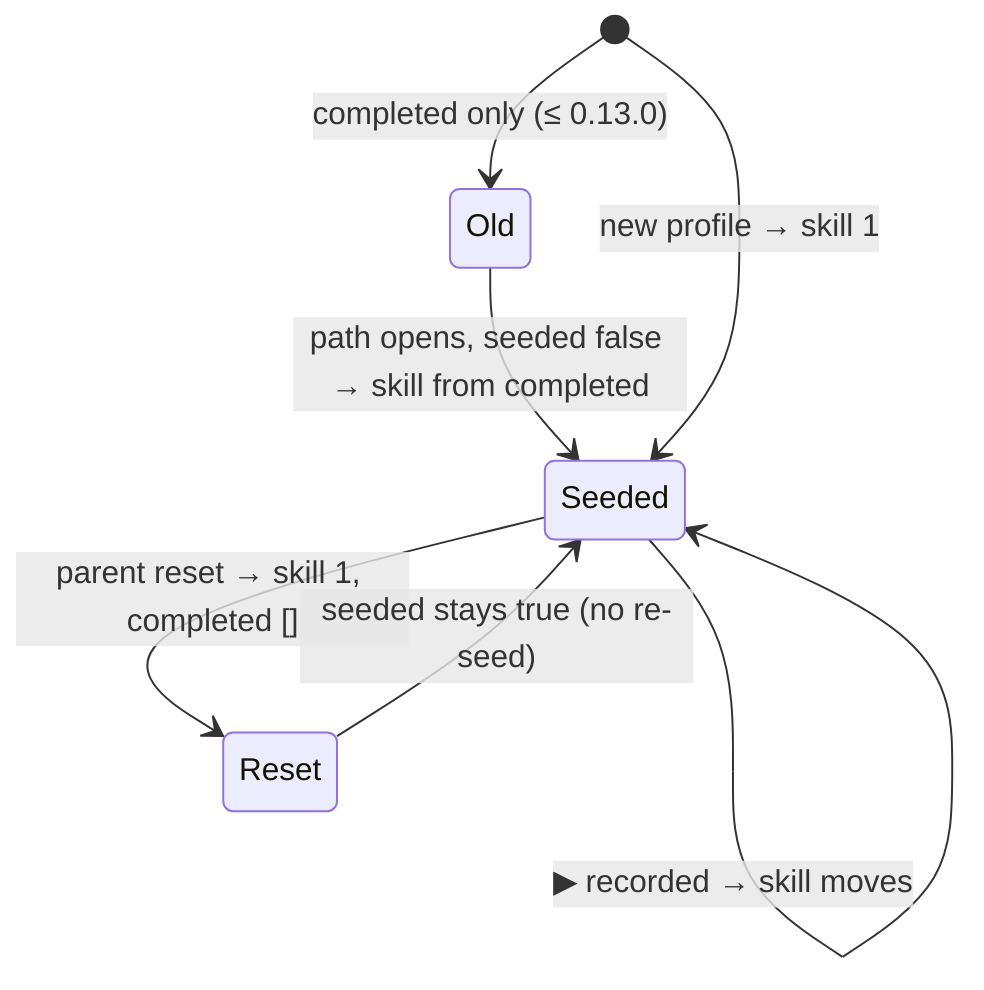

# Migrate games 1, 4, 7 to the new engine — proposal (step M0)

- Scope: La Potion (`potion`), Le Marché (`market`), Qui mange qui ? (`food`) / Step: M0 (design only)
- Branch: dev / Status: proposal, no code / Base commit: 13496a1 (Release v0.13.0)
- Model: Opus 5.5; subagents: none
- Usage consumed: ~125k session tokens (budget checkpoint reached, see "Not done"); plan %: not read
- Full-gate runs: 0 / Reviewer findings: none (no reviewers)
- Questions for review: 6 (max 2 per game, at the end)

Read list: docs/playbooks/migrate-game.md, engine-plan.md 130–139, game-10-proposal.md 1–80,
GAMES.md 18–40, js/progress.js 19–90, js/storage.js 251–262 + 388–415, the 3 games'
CLAUDE.md / levels.js / meta.js, potion.js 70–110, mixing.js 100–180, market.js 100–135,
money.js 60–125, food.js, web.js (exports, levelRounds, makeRound), train levels.js 1–43,
levels.json, levels.schema.json, solver.mjs, grep of memory/jaguar path calls, scene ids.

Taken worlds: meadow, dinosaurs (train), party (balance), space (robot), arctic (shapes),
ocean (memory), jungle (jaguar). Free: savanna, monster. Third theme proposed: **farm**.

## 1. La Potion (game 1)

### Levels
Old ids keep their meaning. Rounds stay hand-made recipes, committed in `levels.json`
(no generator needed: the recipe lists are small and already in `levels.js`).

| old level | new id | step | params (unchanged) |
|---|---|---|---|
| 1 primaries | 1 | 1 | PRIMARIES, ratio, 3 recipes |
| 2 secondaries | 2 | 2 | PRIMARIES, ratio 0.2, 3 recipes |
| 3 review | 3 | 2 | PRIMARIES, ratio 0.2, pick 5 of 6 |
| 4 counting 1–5 | 4 | 3 | counts, showRecipe |
| 5 shades 2+1 | 5 | 4 | counts, showRecipe |
| 6 light/dark | 6 | 5 | ALL, ratio 0.2 |
| 7 3-ingredient | 7 | 6 | ALL, counts, showRecipe |
| 9 detective | 9 | 7 | PRIMARIES, ratio 0.1 |
| 10 master chef | 10 | 8 | ALL, counts, showRecipe |
| 8 free lab | 8 | — | free mode, off the path (`FREE` in levels.js) |
| optional | 11 | 9 | detective with white/black: ALL, ratio 0.1, no recipe (pink-ish / dark shades) |

Curve: 8 steps (9 with id 11). Steps 1–2 are fast; step 2 has two levels so the path
mixes "secondaries" and "review".

### Rounds and solver
- Rounds: committed `rounds: [{ recipe, icon }]`. Play time: `sampleRound(level, rng)`
  picks one round from `level.rounds` (shuffle + pick, with the seeded rng).
- Thread the rng: the local `shuffle` (potion.js:34) and the round pick. The creature
  pick (potion.js:245) and the blob art stay on `Math.random` (they do not change the answer).
- `solve(level)` — "solvable": for every round, `total(recipe) ≤ maxDrops`, every recipe
  id is in `ingredients`, and `matches(recipe, recipe, level.match)` is true.
- "One answer": enumerate every drop vector over `level.ingredients` with total
  1…`maxDrops`. Keep the vectors where `matches(v, recipe, level.match)` is true.
  - `counts` mode: exactly 1 vector matches.
  - `ratio` mode: divide each matching vector by the gcd of its counts. All matches give
    the same reduced vector (= the recipe in lowest terms). So 2+2 = 1+1 is one answer;
    a tolerance that also accepts 2+1 for 1+1 fails.
  - Also: no other round of the same level matches the same reduced vector (two
    creatures never ask for the same mix in one level).
- `sampleRound` returns `{ answers }` = the number of distinct reduced vectors (must be 1).
  Size: 5 ingredients, ≤ 6 drops = 462 vectors; free lab (10 drops) is not a path level.

### Path
- `roundsPerPlay`: 3 (one creature visit ≈ 20–40 s).
- Misses per round = wrong stirs (the count that drives "after 2 wrong attempts").
  `ctx.path.record(level, outcomeForMisses(misses), PATH_LEVELS)`.
- Free mode kept: `onFree` opens id 8.
- Intros: potion levels have no `intro` key today. Add the saved `heard` list only if
  intros are added (Q1).

## 2. Le Marché (game 4)

### Levels
Rounds made at play time (as today). Each level keeps `rounds: 5` for the fixed map.

| old level | new id | step | params (unchanged) |
|---|---|---|---|
| 1 pay with 1 fr | 1 | 1 | coins [1], prices 1–5 |
| 2 add 2 fr | 2 | 2 | coins [1,2], prices 2–6 |
| 3 add 5 fr | 3 | 3 | coins [1,2,5], prices 3–10 |
| 4 two items | 4 | 4 | items 2, total 3–10 |
| 5 seller | 5 | 5 | seller, paidWith 5, prices 1–4 |
| 6 free shop | 6 | — | free mode, off the path |
| optional | 7 | 6 | seller, coins [1,2,5], paidWith 10, prices 1–9 |
| optional | 8 | 7 | items 3, prices 1–4, total 6–10 |

Curve: 5 steps (7 with the optional levels). Five steps is short for quick players (Q3).

### Rounds and solver
- `sampleRound(level, rng)` = `nextBasket(level, null, rng)` (money.js:104, already takes
  `rng`) → `saleTarget(level, total)`.
- Answer: the child must reach one amount. `answers` = 1 when the target is 1…10, can be
  paid with `level.coins` (`fewestCoins` finds a set) and fits the counter (≤ 20).
  Otherwise 0. The seller level also checks `target < paidWith`.
- `solve(level)`: every basket of `possibleBaskets(level)` gives `answers === 1`;
  `minMoves` = the largest `fewestCoins` length (information only).
- Thread the rng in market.js: `pickOne` (market.js:69) and the calls to `pickOther` /
  `pickSome` / `nextBasket` that choose the sale. Animal art can stay on `Math.random`.

### Path
- `roundsPerPlay`: 3 (one sale ≈ 20–40 s).
- Misses per round: **one count = "not enough" submissions + 1 if the child overpaid.**
  Why: the hint ladder (prices → ten-frame → coins wiggle) is driven by the "not
  enough" count, so it is the strongest clue reached. An overpay ends the sale without a
  star; it counts as one more miss, never as a punishment. Example: overpay at once =
  1 → clue (skill does not move). Not enough twice, then exact = 2 → glow (−1).
- Bonus star and "with fewer coins?" stay as they are on the path. The crown (`perfect`)
  stays on the fixed map only.
- Free mode kept: `onFree` opens id 6.
- Intros: levels 2–6 have `intro`. On the path, say it the first time the path picks
  the level: saved `heard: [ids]` (additive, missing = `[]`).

## 3. Qui mange qui ? (game 7)

### Levels
| old level | new id | step | params (unchanged) |
|---|---|---|---|
| 1 feed easy | 1 | 1 | feed, distractors other |
| 2 home 2×2 | 2 | 2 | home, scenes 2, perScene 2 |
| 3 home 3×2 | 3 | 3 | home, scenes 3, perScene 2 |
| 4 feed hard | 4 | 4 | feed, distractors same |
| 5 chain 3 | 5 | 5 | chain, length 3, given 1 |
| 6 chain 3 + decoy | 6 | 6 | chain, length 3, decoys 1 |
| 7 chain 4 | 7 | 7 | chain, length 4 |
| optional | 8 | 4 | home, scenes 3, perScene 3 (if enough single-scene animals) |
| optional | 9 | 8 | chain, length 4, decoys 1 |

No free mode (unchanged). The data tables (HABITATS, PLANTS, ANIMALS, CHAINS) stay in
`levels.js`; only `LEVELS` moves to `levels.json`.

### Decision: (A) full migration vs (B) path only

| | (A) full | (B) path only |
|---|---|---|
| levels.json + schema | yes | yes |
| solver.mjs | `solve` + `sampleRound` wrap `makeRound` / `levelRounds`; answers from `eats`, `homeOf`, `chainSolutions` | none; `tests/food.test.mjs` stays the solver |
| GAMES.md exception | removed | stays |
| rng threading | `makeRound(level, random)` already takes it; `common.js pickOne` (line 3) to thread | same (needed for the path anyway) |
| cost | 3 sessions | 2 sessions |
| risk | `levelRounds` of a home level has thousands of rounds: the gate's 200 samples are cheap, but `solve` must not list them all per gate run more than once (cache) | the gate's levels check skips the solver: a new optional level is checked only by the unit test |

**Recommendation: (A).** The solver is a thin wrapper over functions that exist and are
tested. It costs about one extra session, and it removes the last exception: every game
then follows one rule.

### Rounds and solver (A)
- `sampleRound(level, rng)` = `makeRound(level, rng)`, then answers:
  feed = cards `c` with `eats(animal, c)` (must be 1); home = for each animal, scenes
  where `homeOf` fits (all must be 1); chain = `chainSolutions(round).length` (must be 1).
- `solve(level)`: `levelRounds(level).length > 0`.

### Path
- `roundsPerPlay`: 3. A home round has 4–6 drags (≈ 40–60 s): 3 is still fine.
- Misses: feed = wrong cards; chain = wrong full checks.
  Home = **the highest miss count of one animal**, not the sum. Why: the hints run per
  animal (`homeHint(misses)`), so the strongest clue a child got is the max. A sum would
  turn one miss on each of 4 animals into "again" (as Shapes: strongest clue).
- Intros: levels 2, 4, 5, 6, 7 have `intro` → saved `heard` list (additive).

## 4. Stored data (all 3 games)

| field | written by (app version) | read by | migration |
|---|---|---|---|
| `games.<id>.completed` | game, fixed map (≤ 0.13.0, kept) | fixed map | none, kept as is |
| `games.market.perfect` | market fixed map (≤ 0.13.0, kept) | fixed map (crown) | none |
| `games.<id>.heard` | game, path (new) | game, path | additive, missing = `[]` |
| `games.<id>.seeded` | game, path (new) | game, path | additive, missing = false |
| `skills.<id>` | `ctx.path.record` via js/storage.js `setSkill` | js/progress.js | first value seeded (below) |

Seed rule (runs once per profile per game, when the path opens and `seeded` is false):
- `done` = path levels whose id is in `completed`. Skill = (highest `difficulty` among
  `done`) + 1, capped at the top step; no level done → 1. `best` = skill.
- Then `seeded = true` (saved in the game data, so a parent "reset difficulty" is not
  undone by a second seed).
- Code: game-local `seedSkill()` in each game's home code (or one copy per game, 10
  lines). It needs a way to write the first skill. If `ctx.path` has no seed entry, add
  an optional `start` to `ctx.path.show` in js/ — **shared code, full gate** (to verify in
  session S0; I did not read js/path.js).

## 5. Worlds

| game | pack | theme | gift (items[0]) | item ideas |
|---|---|---|---|---|
| potion | `monster` | friendly potion monsters | a bubbling cauldron | small monster, spell book, mushroom, potion bottles |
| market | `farm` | a farm market | a vegetable cart | hen, cow, pumpkin, haystack |
| food | `savanna` | the savanna | an acacia tree | giraffe, zebra, elephant, watering hole |

Monster: free placement, like every other pack. No slots asked. If the artist wants
monsters "in" cauldrons (slots), that is shared code (js/scene.js): not proposed.
The savanna pack must not show predation (food rule): lion art without prey.

## 6. Tests

| file | stays | replaced by the gate solver |
|---|---|---|
| tests/mixing.test.mjs | RYB model, `matches`, `nameColor`, `missingIngredient` | none; add: every level round has one reduced answer (also in solver) |
| tests/market.test.mjs | `fewestCoins` vs brute force, `hasChoice`, `stacks`, `frameDots`, plural | "every basket payable / change possible" (kept as a fast unit copy) |
| tests/food.test.mjs | diet rules, no predation, ice floe, decoy rules | "every round has one answer" → solver (A); keep the exhaustive list test |

## 7. Step plan

Order: **market → potion → food**. Market is closest to Train (rounds at play time,
rng already threaded). Potion is the first "committed rounds + sampleRound" game. Food
is last (three round types, the largest solver).

| session | content | model | shared code |
|---|---|---|---|
| S0 | seed hook in `ctx.path` if needed (js/), full gate by the owner | Opus | yes |
| M1 | market levels.json, schema, solver, levels.js, rng thread, unit tests | Opus (first of the seed pattern) | no |
| M2 | market path, heard, misses, farm pack, checks, preview.23 | Sonnet | no |
| P1 | potion levels.json, schema, solver (enumeration), rng | Sonnet | no |
| P2 | potion path, monster pack, checks, preview.24 | Sonnet | no |
| F1 | food levels.json + schema + solver (A) | Opus (first multi-type solver) | no |
| F2 | food path (home max-misses), heard | Sonnet | no |
| F3 | savanna pack, checks, preview.25 | Sonnet | no |

Total: 7 sessions (8 with S0). Each stays under 110k if it reads only its game files.
S0 is skipped if `ctx.path` already accepts a first skill.

## 8. Risks
- Potion recipes may fail "one answer" in `ratio` 0.2 levels (e.g. 2+1 also accepted for
  1+1). Fix in data (tolerance), never in the solver.
- Market: 5 steps; quick players reach the top fast without the optional levels.
- Food home: the kids finished it fast; the path does not add depth without optional
  levels 8–9.
- Seeding needs js/ if `ctx.path` has no seed entry (full gate, pwa-guardian).

## 9. Questions (owner)
1. Potion: add intros for the hard levels (detective, master chef)? Then the `heard` list.
2. Potion: add optional id 11 (detective with white/black)?
3. Market: add optional ids 7 (change from 10) and 8 (three items)?
4. Market: overpay = one extra miss. OK?
5. Food: (A) full migration, as recommended?
6. Food: add optional ids 8 (home 3×3) and 9 (chain 4 + decoy)?

## Not done
- Not read: CLAUDE.md 12–55 / 157–186 (rules taken from the loaded copy), js/path.js
  (seed entry unknown), the three test files (section 6 is from the game notes).
- Potion "one answer" not run on the real recipes: P1 measures it.
- Food optional id 8: not checked that 3 scenes × 3 single-scene animals exist.

## 10. Owner decisions (2026-10-11)
These replace the proposal where they differ.
- D1. Seed of the first path skill: ONE place, shared code. No per-game seedSkill(). No `seeded` field.
- D2. Seed rule: skill = the highest `difficulty` among the path levels whose id is in the game's old `completed` list. No +1. No completed path level → no seed (the state stays missing = START). best = skill.
- D3. When: in path.show(), only when getSkill(profileId, gameId) is null. A skill that exists (also after the parent's resetSkill, which keeps the state at skill 1) is never seeded again. All path games get this (Train, Balance, Robot, Shapes, Memory, Jaguar too): OK.
- D4. Potion solver: "one answer" = for each round R of a level, the number of rounds R2 of the same level with matches(R.recipe, R2.recipe, level.match) === true must be 1 (only R itself). The ratio tolerance is on purpose (mixing.js lines 105-107): never change it to pass the solver.
- D5. Questions 1-6 of the proposal: all YES, except food optional id 8 (home 3x3): only if F1 shows there are enough single-scene animals.
