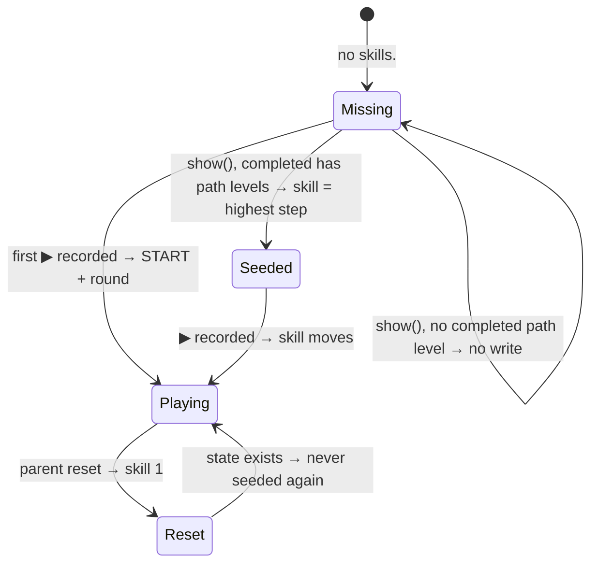

# Migrate S0 — seed the first path skill (shared code)

- Model: Opus 5.5 · usage: ~90k tokens · full-gate runs: 0 — owner to run · reviewers: none yet (pwa-guardian after the full gate)
- Commit: ca65a02 (code + tests), on `dev`.

## What changed
- `js/progress.js` 74–85: new pure function `seedSkill(levels, completedIds)` → `{ ...START, seen: [], skill, best }` or `null`. Header comment added.
- `js/path.js` 12–14 (header), 23–24 (imports), 39–44 (`show()`): when `getSkill()` is `null`, read `getGameData().completed`, call `seedSkill()`, call `setSkill()` if the result is not `null`. This runs before the stones are drawn.
- `tests/progress.test.mjs` 9–19: 2 tests for `seedSkill` (no completed, `undefined`, free-mode ids only → `null`; ids `s2` + `s5` + a free id → skill 5, best 5, rounds 0, seen `[]`).
- No game changed. No storage format change (no new field, no `SCHEMA_VERSION` bump).

## Test results
- `node --test tests/progress.test.mjs tests/path.test.mjs tests/storage.test.mjs`: 38 pass, 0 fail.
- `node tools/gate.mjs --only privacy`: PASS.
- `tests/path.test.mjs`: no case added. No `localStorage` fake exists in `tests/storage.test.mjs` or `tests/fixtures/*.mjs` (grep). I did not build one (task rule). The seed call in `path.show()` has no unit test.

## Stored data
| field | written by | read by | migration |
|---|---|---|---|
| `games.<id>.completed` | game fixed map (≤ 0.13.0, kept) | fixed map; `path.show()` (seed, new) | none, read only |
| `skills.<id>` | `path.show()` seed (new, once); `ctx.path.record` | js/progress.js, `path.show()` | missing = START; seeded once if `completed` has a path level |

## Risks
- The seed runs for every path game (Train, Balance, Robot, Shapes, Memory, Jaguar, and the next ones). A child with old completed levels at a high step starts there, not at 1 (D2, on purpose).
- `seedSkill` matches ids with `Set.has` (strict). If a game's `completed` list holds ids of another type than `levels.json` ids (number vs string), no seed happens. Check per game in its migration step.
- Shared code: the full gate and pwa-guardian have not run.

## Questions
1. Add a `localStorage` fake in `tests/fixtures/` to test the seed in `path.show()`? (tests only, small)
